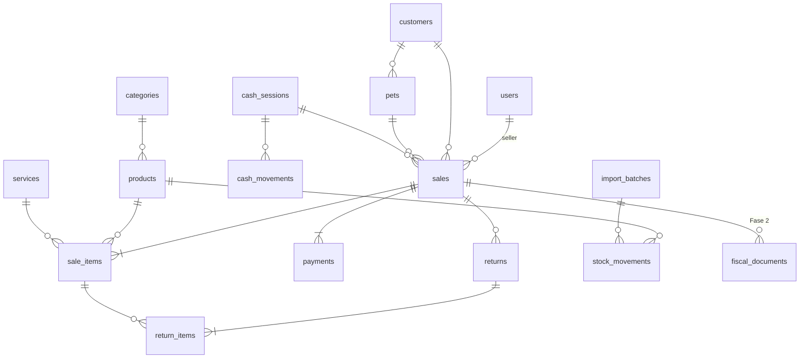

# 05 — Modelo de Dados

PostgreSQL. Convenções: tabelas e colunas em `snake_case` e inglês; PK `uuid` (exceto `audit_log.id bigint`); datas `timestamptz` UTC; dinheiro em `integer` (centavos) com `CHECK`; todo registro tem `created_at`; mutáveis têm `updated_at`. Enums como `enum` do Postgres (ou `text` + `CHECK`). Extensões: `unaccent`, `pg_trgm`.

## Diagrama (visão lógica)

## Tabelas

### users
`id`, `name`, `email` (único, `citext` ou normalizado), `password_hash`, `role` (`OWNER`), `active` bool, `failed_attempts` int, `locked_until` timestamptz null, `created_at`, `updated_at`. Sessões em tabela própria conforme a biblioteca de auth (ADR-011).

### categories
`id`, `name`, `name_normalized` (único), `created_at`.

### products
| Coluna | Tipo / regra |
|---|---|
| `id` | uuid PK |
| `name`, `name_normalized` | text; único parcial `WHERE archived_at IS NULL` em `name_normalized` (RN-CAT-02) |
| `barcode` | text null; **único** entre todos (RN-CAT-03) |
| `category_id` | FK `categories` null |
| `price_cents` | int `CHECK ≥ 0` |
| `cost_cents` | int null `CHECK ≥ 0` |
| `stock_qty` | int **`CHECK ≥ 0`** default 0 — cache, só `inventory` escreve (ADR-007) |
| `min_stock` | int `CHECK ≥ 0` default 0 |
| `photo_key` | text null (chave no `FileStorage`) |
| `ncm` char(8), `cest` text, `cfop` char(4), `csosn` char(3), `origin` smallint, `unit` char(2) default `'UN'` | todos nulos, formato validado (RN-FIS-02) |
| `archived_at` | timestamptz null |

Índices: GIN `pg_trgm` em `name_normalized`; único em `barcode` (onde não nulo); `(category_id)`; parcial `(stock_qty, min_stock) WHERE min_stock > 0` para alerta.

### services
`id`, `name`, `name_normalized` (único parcial entre ativos), `price_cents` `CHECK ≥ 0`, `is_displacement_fee` bool (**único parcial** `WHERE is_displacement_fee` → no máximo uma taxa), `fiscal_service_code` text null, `archived_at`, `created_at`, `updated_at`.

### customers
`id`, `name`, `phone_e164` null, `cpf` char(11) null (**único** onde não nulo), `address_street`, `address_number`, `address_district`, `address_complement`, `address_reference`, `address_city`, `address_state`, `address_zip` (todos nulos), `anonymized_at` null, `created_at`, `updated_at`. Índices: `phone_e164`, trigram em nome normalizado.

### pets
`id`, `customer_id` FK, `name`, `species` (`DOG`/`CAT`/`OTHER`), `breed`, `birth_date` null, `notes`, `archived_at`, `created_at`. Índice `(customer_id)`.

### cash_sessions
`id`, `status` (`OPEN`/`CLOSED`), `opened_by` FK, `opened_at`, `opening_cents` `CHECK ≥ 0`, `closed_by` null, `closed_at` null, `expected_cash_cents` null, `counted_cash_cents` null, `difference_cents` null, `closing_note` null.
**Único parcial:** `CREATE UNIQUE INDEX one_open_session ON cash_sessions ((true)) WHERE status = 'OPEN';` (RN-CAI-01).

### cash_movements
`id`, `session_id` FK, `type` (`SUPPLY`, `WITHDRAWAL`, `SALE_CASH`, `SALE_CASH_HOME`, `REFUND_CASH`), `amount_cents` `CHECK > 0`, `reason` null (obrigatório em `SUPPLY`/`WITHDRAWAL`), `sale_id` null, `return_id` null, `user_id`, `created_at`.
Efeito na gaveta: **entram** `SUPPLY`, `SALE_CASH`; **saem** `WITHDRAWAL`, `REFUND_CASH`; `SALE_CASH_HOME` **não afeta** a gaveta (RN-CAI-05). Imutável.

### sales
| Coluna | Observação |
|---|---|
| `id`, `number` | `number` bigint identity, único |
| `status` | `HELD` / `COMPLETED` / `DISCARDED` |
| `session_id` | FK null; preenchido na finalização |
| `seller_id` | FK `users` |
| `channel` | `STORE` / `HOME_VISIT` |
| `customer_id`, `pet_id` | FK null |
| `service_address` | text null (snapshot do endereço do atendimento) |
| `customer_cpf` | char(11) null (CPF na nota, RN-VEN-13) |
| `discount_type` | `NONE` / `AMOUNT` / `PERCENT` |
| `discount_value` | int (centavos ou pontos percentuais inteiros — ver nota) |
| `discount_reason` | text null |
| `subtotal_cents`, `discount_cents`, `total_cents` | int `CHECK ≥ 0` (total > 0 exigido na finalização) |
| `idempotency_key` | uuid **único** null |
| `fiscal_status` | `NOT_ISSUED` (Fase 1) / `PENDING` / `AUTHORIZED` / `REJECTED` / `CANCELLED` |
| `note` | text null |
| `held_at`, `completed_at`, `created_at`, `updated_at` | timestamptz |

Nota: `discount_value` para `PERCENT` guarda o percentual em **centésimos de ponto** (ex.: 10,5% → 1050) para evitar decimais.
Índices: `(completed_at)`, `(session_id)`, `(customer_id)`, `(status)` parcial para `HELD`.
Constraint: `HOME_VISIT` exige `customer_id` e `service_address`; `COMPLETED` exige `session_id`, `completed_at`, `total_cents > 0`.

### sale_items
`id`, `sale_id` FK, `line_no`, `kind` (`PRODUCT`/`SERVICE`), `product_id` / `service_id` (**exatamente um**, `CHECK`), `name_snapshot`, `quantity` int `CHECK > 0`, `unit_list_price_cents`, `unit_price_cents` (praticado), `unit_cost_cents` null, `gross_total_cents` (= quantidade × preço praticado), `discount_share_cents`, `net_total_cents` (= bruto − parcela do desconto), `fiscal_snapshot` jsonb null. Índices: `(sale_id)`, `(product_id)`, `(service_id)`.

### payments
`id`, `sale_id` FK, `method` (`CASH`/`DEBIT`/`CREDIT`/`PIX`), `applied_cents` `CHECK > 0`, `received_cents` null, `change_cents` null (os dois só em `CASH`, `CHECK`), `created_at`. Invariante (no caso de uso e verificada por teste): `Σ applied_cents = sales.total_cents`.

### returns / return_items
`returns`: `id`, `sale_id` FK, `session_id` FK, `user_id`, `reason` (obrigatório), `refund_method` (`CASH`/`EXTERNAL`), `refund_cents` `CHECK ≥ 0`, `created_at`.
`return_items`: `id`, `return_id` FK, `sale_item_id` FK, `quantity` `CHECK > 0`, `refund_cents` `CHECK ≥ 0`, `restock` (`RESTOCK`/`LOSS`/`NONE`; `NONE` para serviços). Invariante: `Σ quantity por sale_item ≤ sale_items.quantity`.

### stock_movements
`id`, `product_id` FK, `type` (`INITIAL`/`PURCHASE_IN`/`SALE_OUT`/`RETURN_IN`/`ADJUSTMENT`/`LOSS`), `quantity_delta` int `CHECK ≠ 0`, `balance_after` int `CHECK ≥ 0`, `unit_cost_cents` null, `reason` null (obrigatório em `ADJUSTMENT`/`LOSS`), `ref_type` (`SALE`/`RETURN`/`IMPORT`/`MANUAL`) null, `ref_id` uuid null, `user_id`, `created_at`. Índice `(product_id, created_at)`. Imutável (sem `UPDATE`/`DELETE` para a aplicação).

### import_batches
`id`, `user_id`, `file_name`, `file_sha256`, `total_rows`, `created_count`, `updated_count`, `skipped_count`, `error_count`, `created_at`. Índice em `file_sha256`.

### audit_log
`id` bigint identity, `user_id` null, `action` text, `entity_type` text, `entity_id` text null, `data` jsonb (**sem dados pessoais**), `created_at`. Append-only. Índices `(entity_type, entity_id)`, `(created_at)`.

### outbox (Fase 2)
`id`, `type`, `payload` jsonb, `created_at`, `processed_at` null, `attempts` int. Escrita na mesma transação da venda.

### fiscal_documents (Fase 2)
`id`, `sale_id` FK, `kind` (`NFCE`/`NFSE`), `status`, `provider`, `provider_ref`, `access_key` null, `number`, `series`, `xml_key`/`pdf_key` (referências de arquivo), `rejection_code`, `rejection_message`, `payload_snapshot` jsonb, `attempts`, `issued_at`, `created_at`, `updated_at`. Venda mista gera **dois** documentos (um por tipo). Ver `06`.

## Invariantes garantidas pelo banco

| Invariante | Mecanismo |
|---|---|
| Estoque não negativo | `CHECK (stock_qty >= 0)` + `UPDATE … WHERE stock_qty >= :q` |
| Uma sessão de caixa aberta | índice único parcial |
| Venda não duplica por reenvio | `UNIQUE (idempotency_key)` |
| Código de barras único | índice único |
| CPF único quando informado | índice único parcial |
| Uma taxa de deslocamento | índice único parcial |
| Item é produto **ou** serviço | `CHECK` |
| Dinheiro nunca fracionado/negativo | tipos `integer` e `CHECK`s |
| Imutabilidade de movimentos/auditoria | privilégios do usuário da aplicação |

## Invariantes verificadas por teste

`products.stock_qty = Σ stock_movements.quantity_delta`; `Σ payments.applied = sales.total`; `Σ sale_items.net_total = sales.total`; `Σ return_items.quantity ≤ sale_items.quantity`; gaveta = `opening + entradas − saídas`.

## Dados semente (seed)

- Usuários: **não** no seed de produção (criados por `scripts/create-user.ts`).
- Serviços iniciais e taxa de deslocamento (`config/business.ts`, RN-SER-01).
- Categorias sugeridas `[OQ-18]`: Alimentos, Brinquedos, Acessórios, Higiene (editáveis).
- Dados de **desenvolvimento/teste**: factories em `tests/helpers`; planilhas de exemplo em `tests/fixtures`.

## Migrações

Versionadas e revisadas; `CHECK`, índices parciais, extensões e `GRANT/REVOKE` em arquivos SQL manuais dentro das migrações; estratégia **expandir → migrar → contrair** (RNF-INT-05); nunca editar migração já aplicada em produção.
